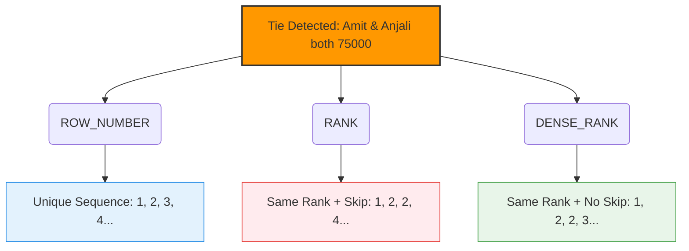

# 🚀 Advanced PostgreSQL: Mastering Window Functions


---

## 📌 Overview

Window Functions perform calculations across a set of table rows that are related to the current row.  

Unlike regular aggregate functions (`GROUP BY`), **Window Functions do not collapse rows**. They return a value for **every row**.

### Most Common Window Functions

| Function          | Purpose                                      |
|-------------------|----------------------------------------------|
| `ROW_NUMBER()`    | Assigns a unique sequential number           |
| `RANK()`          | Ranking with gaps on ties                    |
| `DENSE_RANK()`    | Ranking without gaps on ties                 |
| `LAG()` / `LEAD()`| Access previous / next row value             |
| `SUM() OVER()`    | Running total                                |
| `AVG() OVER()`    | Moving average                               |

---

## 🛠️ Basic Syntax

```sql
FUNCTION_NAME() OVER (
  PARTITION BY column_name   -- Divides rows into groups
  ORDER BY column_name       -- Defines order inside each partition
)
```
---

## 🗄️ Dataset: `employees` Table

| id | name | department | salary |
| :---: | :--- | :--- | :---: |
| **1** | Rahul | IT | 60000 |
| **2** | Priya | HR | 45000 |
| **3** | Amit | IT | 75000 |
| **4** | Sneha | Finance | 52000 |
| **5** | Vikram | IT | 68000 |
| **6** | Neha | HR | 48000 |
| **7** | Karan | Finance | 81000 |
| **8** | Anjali | IT | 75000 |

---
## 🧠 Visual Guide: ROW_NUMBER vs RANK vs DENSE_RANK

When there is a tie (e.g., Amit and Anjali both have `salary = 75000`), the ranking functions behave differently:



---

## 🎯 Tasks & Solutions

### 🔹 Task 1: Unique Row Number by Salary (Highest → Lowest)

```sql
SELECT 
    name, 
    department, 
    salary, 
    ROW_NUMBER() OVER (ORDER BY salary DESC) AS row_num 
FROM employees;
```

---

### 🔹 Task 2: Rank Within Each Department (RANK)

```sql
SELECT 
    name, 
    department, 
    salary, 
    RANK() OVER (PARTITION BY department ORDER BY salary DESC) AS rank_in_dept 
FROM employees;
```

---

### 🔹 Task 3: Dense Rank Within Each Department (DENSE_RANK)

```sql
SELECT 
    name, 
    department, 
    salary, 
    DENSE_RANK() OVER (PARTITION BY department ORDER BY salary DESC) AS dense_rank_in_dept 
FROM employees;
```

---

### 🔹 Task 4: Top 2 Highest Paid Employees in Each Department

```sql
SELECT 
    name, 
    department, 
    salary 
FROM (
    SELECT 
        name, 
        department, 
        salary, 
        ROW_NUMBER() OVER (PARTITION BY department ORDER BY salary DESC) AS rn 
    FROM employees
) ranked 
WHERE rn <= 2;
```

---

### 🔹 Task 5: Previous Higher Salary using LAG()

```sql
SELECT 
    name, 
    department, 
    salary, 
    LAG(salary) OVER (PARTITION BY department ORDER BY salary DESC) AS previous_higher_salary 
FROM employees;
```

---

## 💡 Key Takeaways for Interviews

* **`ROW_NUMBER()`** ➡️ Always generates unique sequential numbers.
* **`RANK()`** ➡️ Assigns the same rank for ties + skips the next sequence number.
* **`DENSE_RANK()`** ➡️ Assigns the same rank for ties + does **not** skip any numbers.
* **Row Retention** ➡️ Window functions never reduce or collapse the final output row count.
* **`PARTITION BY` vs `GROUP BY`** ➡️ `PARTITION BY` groups records like a `GROUP BY` clause but preserves the individual rows.
* **"Top N per group" Problems** ➡️ Almost always solved using a combination of `ROW_NUMBER()` / `DENSE_RANK()` inside a subquery.

---

## 🔥 Bonus Challenge

**Problem:** Find the employee with the second highest salary in each department.

**Solution:**
```sql
SELECT 
    name, 
    department, 
    salary 
FROM (
    SELECT 
        name, 
        department, 
        salary, 
        DENSE_RANK() OVER (PARTITION BY department ORDER BY salary DESC) AS dr 
    FROM employees
) ranked 
WHERE dr = 2;
```

> 📌 **Note:** We intentionally use `DENSE_RANK()` here. If multiple people share the top highest salary, the next distinct lower salary still correctly gets assigned rank 2.
